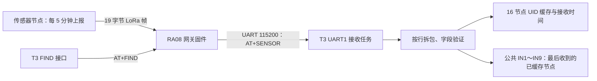

# T3 LoRa 网关：协议核对与联调

核对日期：2026-10-26。T3 源码为 `main/lora.c`、`main/lora.h`、
`main/tcp_server.c`。模块源码来自：

```text
D:\个人文件\文档\GitHub\MPPT\ra08-solar-polling
```

下文的模块路径均相对该目录。此次只修改 T3 项目，模块源码用于核对。

## 1. 真实运行链路



T3 `Modbus.mini_type == PROJECT_LORA_GATEWAY`（28）才调用 `lora_start()`。
UART1：TX GPIO12、RX GPIO15、115200、8N1、无流控。
普通 UART2 初始化和相应发送在网关模式下被跳过，避免抢占 GPIO12/15。

RA08 项目不是通用 AT 固件。实际项目为：

```text
projects/ASR6601CB-EVAL/examples/lora/lora_myself_net
```

其 `components/lora_driver/lora_driver.c` 的 `handler_uart_data()` 只实现
ASCII `AT+FIND=`；没有 `AT`、`AT+CADDRSET`、`AT+CTXADDRSET`、`AT+CTX`、
`+++` 或 `MSG/ACK` 文本协议。其他示例中的 `lora_test` 命令不能套用。

因此 T3 启动直接建立串口接收，不发送这些无效命令，也不等待不存在的 `OK`。
RA08 自己初始化射频并在网关分支执行连续接收。

## 2. 实际射频参数与角色

以 `lora_driver.c` 执行语句为准：

| 参数 | 当前源码值 |
|---|---|
| 频率 | `Radio.SetChannel(433953525)`，即 433.953525 MHz |
| 带宽 | 125 kHz |
| 扩频因子 | SF7 |
| 编码率 | 4/5 |
| 前导码 | 8 |
| 可变长度 | 是 |
| IQ 反转 | 否 |
| 发射功率 | 14 dBm |
| 无线 CRC | TX/RX 均启用 |
| 网关接收 | `Radio.Rx(0)`；发送完成、接收异常后恢复接收 |

注意：Makefile 的 `REGION_CN470` 和用于日志的 `RF_FREQUENCY` 宏不是当前
`Radio.SetChannel()` 的实参，不能据此认为实际运行在 470 MHz 或 868 MHz。

核对时 `components/lora_driver/include/lora_config.h` 中
`//#define CONFIG_GATEWAY (1)` 被注释，项目 Makefile 也没有定义该宏。
默认源码配置是节点角色；编译网关 RA08 时必须定义 `CONFIG_GATEWAY`。
这不能证明已烧录的硬件角色，需要结合实际构建参数/启动输出确认。
节点和网关应使用分别管理的构建配置，避免把节点固件烧进网关模块。

## 3. 数据协议与验证

当前节点上报二进制帧：

```text
A0 21 UID[4] T_x100[2] RH_x100[2] Vcap_mV[2]
      CO2_ppm[2] TVOC_ppb[2] LUX[2] A1
```

共 19 字节，数值高字节在前。RA08 网关将它转换成：

```text
AT+SENSOR=A1B2C3D4,2234,5566,3300,888,123,456,-70,9\r\n
```

T3 验证：

- UID 必须恰好 8 个十六进制字符，统一为大写后匹配。
- 必须恰好 9 个字段，拒绝空字段、额外字段、数字后缀、截断和溢出。
- 温度按模块的 `int16_t`；电压、CO₂、TVOC、光照按 `uint16_t`。
- RH 为 0～10000；RSSI/SNR 按模块输出的 `int8_t`。
- 超长行或含 NUL 的行整行丢弃，到下一换行符重新同步。
- UART 分片、连续多行、CR/LF/CRLF 均可处理。

无线层已经开启 CRC；**RA08→T3 的 UART 文本没有应用层校验和**。
当前没有单方面给 SENSOR 加 CRC/ACK，否则会与节点/模块协议不兼容。
若要增加 UART 校验，应同步升级 RA08 的 `serial_output()` 报文格式和 T3 解析。

模块还识别 11/13/17 字节旧无线帧，但这些分支只有 `printf`，而网关编译中
`lora_driver.c` 将 `printf` 屏蔽；只有 19 字节分支通过 `serial_output()` 转发
`AT+SENSOR`。旧节点不出现在 T3 上时，应先核对报文版本。

## 4. 缓存与点表

最多缓存 16 个 UID。相同 UID 更新原槽；满表时保留原有节点，拒绝新 UID 并计数。
缓存只在 RAM 中，不持久化，也不会因离线自动删除或改变槽号。

节点当前上报间隔 `CONFIG_NODE_REPORT_INTERVAL_MS = 300000`（5 分钟）。
T3 默认 `LORA_SENSOR_TIMEOUT_MS = 900000`（15 分钟）；在读取 API 时计算
`age_ms` 和 `online`。离线保留最后一份数据，`valid` 表示有历史数据，
不等于在线。缓存访问使用临界区，避免读到半份更新。

| 点位 | 含义 | 内部 value |
|---|---|---|
| IN1 | UID | 保留原始 uint32 位模式；完整十六进制写入描述 `LORA UID XXXXXXXX` |
| IN2 | 温度 ℃ | `T_x100 × 10` |
| IN3 | 湿度 % | `RH_x100 × 10` |
| IN4 | 电压 V | `Vcap_mV` |
| IN5 | CO₂ ppm | `CO2 × 1000` |
| IN6 | TVOC ppb | `TVOC × 1000` |
| IN7 | 光照 lux | `LUX × 1000` |
| IN8 | RSSI | `RSSI × 1000` |
| IN9 | SNR | `SNR × 1000` |

IN1 数值字段不是按千倍表示的 UID 工程值；高位 UID 会呈现为有符号负数。
读取准确 UID 应用字符串 API 或输入点描述。IN2～IN9 使用控制器千倍定点单位。

当前仍为公共 IN1～IN9，最新收到且进入缓存的节点覆盖这组点位。
网关 `base_in/input_end` 配置为 32，默认 `MAX_INS` 为 64；16×9=144 个
独立点位不能只修改 `MAX_SENSORS` 实现。完整独立映射需另行确定节点数、
UID 绑定、持久化和 Modbus/BACnet 点表扩展。
离线状态目前由 API 提供，没有自动清空点值或添加上位机状态点。

## 5. 下行限制

`lora_send_find_command(addr, duration)` 一次写入完整的
`AT+FIND=addr,duration\r\n`，用互斥锁防止并发写入混杂。返回 true 仅代表
串口写入完整；模块不回 OK。非法地址归为 255；时长默认 5 秒、最大 60 秒。

模块收到 FIND 后发出 `A0 F9 addr duration checksum A1`。无线 FIND ACK
为 `A0 FA addr status checksum A1`，不是旧 T3 代码里的文本 `ACK:seq:CRC`。
模块处理 FIND ACK 时只打印调试文字，未转发给 T3，且网关打印已被屏蔽。

更关键的是，当前节点启动和 TX 完成后执行 `Radio.Sleep()`，是 TX-only
上报模式，没有主动接收窗口。要实现可靠 FIND/其他下行，需要先在节点端
设计接收窗口、功耗与发送时机，并让 RA08 网关转发执行确认。

`lora_send_payload_reliable()` 保留公共符号，但在当前协议下直接返回 false，
记录 `ESP_ERR_NOT_SUPPORTED`，不向 UART 发送错误的 868 MHz CTX/MSG 命令。

## 6. 诊断 API 与验收

```c
lora_status_t status;
lora_get_status(&status);

lora_sensor_data_t sample;
if (lora_get_sensor_data("A1B2C3D4", &sample)) {
    /* sample.valid: 有历史数据；sample.online: 未超时 */
}
for (size_t slot = 0; slot < LORA_MAX_SENSORS; ++slot) {
    if (lora_get_sensor_by_index(slot, &sample)) {
        /* 枚举缓存，不依赖公共 IN1～IN9 当前显示哪个节点。 */
    }
}
```

`LORA_READY` 只表示 T3 UART/任务创建成功。确认无线数据链路应观察
`sensor_frames` 增加、`last_sensor_ms` 刷新和对应 UID 的 `online`。
另外提供 `invalid_frames`、`dropped_lines`、`cache_full`、`tx_failures`、
`module_drop_frames`。如果看见模块启动文本 `Node init OK`，
`node_firmware_detected` 会置 true，直到 T3 重启。

日志走 ESP_LOG，遵守应用全局日志设置。当前 `app_main()` 将日志设为 NONE；
不要恢复无条件 printf 到已作 RS485 使用的 UART0 来绕过它。
可通过调试器/后续状态接口读以上结构，或在单独调试固件中规划独立控制台。

硬件验收顺序：

1. 核对 T3 类型为 28、RA08 为网关角色、双方 UART 接线与共地。
2. 核对两端固件实际射频参数与 19 字节报文版本。
3. 接入一个节点，观察 SENSOR 计数和 IN2～IN9 工程值。
4. 接入第二节点，确认两个 UID 的缓存各自更新，公共点随最新节点切换。
5. 超过 15 分钟未上报，API 应显示离线而保留最后值；恢复上报后重新在线。
6. 当前 TX-only 节点不以 FIND 闪灯作为接收链路验收条件。

## 7. 自动验证

主机测试直接复制生产 `lora.c/lora.h` 编译，替换 UART/FreeRTOS/点表依赖：

```text
python test/lora/run_tests.py --cc <gcc、clang 或 zig 可执行文件路径>
```

覆盖无 AT 握手启动、初始化失败重试、重复启动保留缓存、严格解析、
点值缩放、UID 规范化、离线恢复、单字节拆包、整块多行、超长/NUL 恢复、
16 节点满表、无 OK 的 FIND、短写失败、禁止不支持的可靠发送。
主机模拟不验证真实 FreeRTOS 双核调度、UART 电气或无线收发。

ESP-IDF 编译使用本机 5.5.3 环境。构建生成 `build/temco_app.bin` 后仍需检查
分区：当前 `temco_partitions.cvs` 的 factory 只有 1 MiB，完整应用大于它，
构建器会提示 factory 溢出。此处没有改分区或烧录；部署前应核对设备实际
分区表和使用的 app 槽，不能把编译成功当作可直接写入 factory 的依据。
