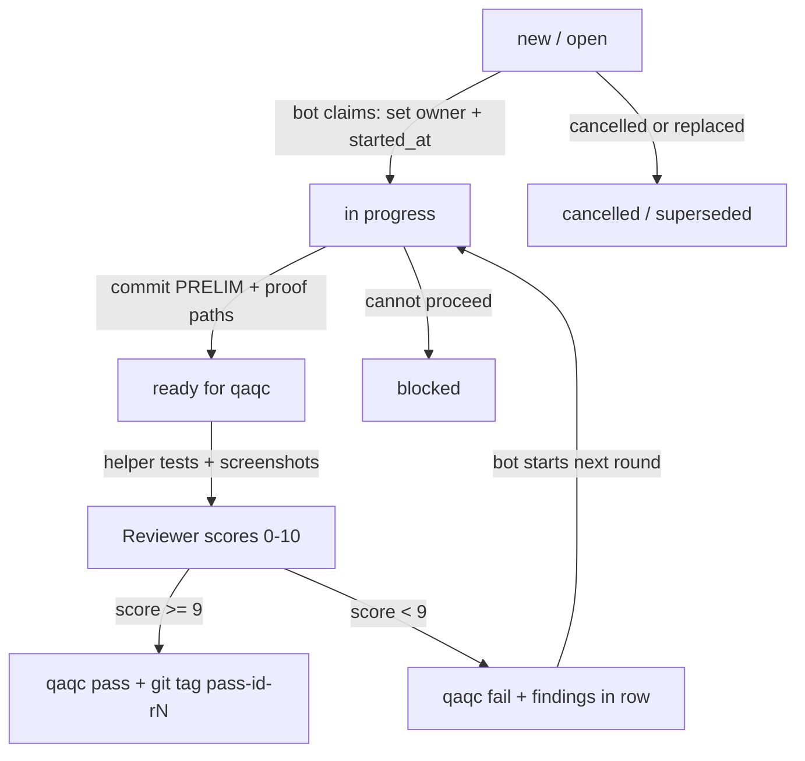

# Workflow: row lifecycle

All communication between coding bots and the QAQC reviewer goes through the row.
Do not use private chat, sticky notes, or other side channels for status.

## Lifecycle diagram



## Step by step

### 1. Create a row

Someone (you or a coordinator) inserts a row:

- `title` / `description` / `command` = what to do
- `project` = your project name (required for filtering)
- `status` = `'new'` or `'open'`
- `classification` = `'command'` (or `'regression'`)
- `table_view_id` = `'debug'` if you use a Debug-style UI
- `source` / `created_by` = who filed it
- `created_at` / `updated_at` = Unix ms now
- `notes` = start with a `[NEW …]` line

### 2. Claim (coding bot)

Bot picks a free row for its project:

- `owner` is null (or empty)
- `status` in (`new`, `open`, `qaqc fail`) — fail means “work the findings”

Bot updates atomically:

- `owner` = bot name (`cursor`, `vscode`, `doubao`, …)
- `status` = `'in progress'`
- `started_at` / `updated_at` = now
- append `[START …]` to `notes`
- bump `qaqc_round` when starting a new round after a fail (see below)

**Two bots never edit the same file at once.** Agree ownership up front (example: Bot A owns MainActivity + Gradle; Bot B stays out of those files).

### 3. Code and commit

Commit message prefix:

```text
[PRELIM] <row> rN
```

Examples:

```text
[PRELIM] 365 r1
[PRELIM] 365 r2
```

- `<row>` = `id` (or `todo_number` if you standardize on that — Temco uses `id`)
- `rN` = round = `qaqc_round` (1, 2, 3, …)
- Push to the working branch. **No PR** unless someone asks.

Also put proof where others can see it:

- Build / APK path in `test_url`
- SHA in `commit_sha`
- Short test notes in `notes` / `testing_evidence`
- Screenshots later under `X:\CRM\Tasks\<row>\<tester>\` (or your Tasks root)

### 4. Mark ready for QAQC

```text
status        = 'ready for qaqc'
commit_sha    = '<sha>'
test_url      = '<path or url>'
updated_at    = now
notes        += '[READY …] round N commit <sha> …'
```

First-phase QAQC (hands-on):

- A helper installs the build and clicks through acceptance criteria.
- Saves screenshots + notes under `…\Tasks\<row>\<tester>\`.
- Does **not** need to be the scoring agent.

### 5. Score (reviewer)

Pass rule: **9/10 or higher**.

On pass:

```text
status         = 'qaqc pass'
qaqc_score     = 9   -- or 10
qaqc_findings  = '…'
qaqc_at        = now
updated_at     = now
```

Git tag:

```text
pass-<row>-rN
```

Example: `pass-365-r1`

Optional: add a `[PASS]` label in notes or your issue tracker.

On fail:

```text
status         = 'qaqc fail'
qaqc_score     = <0-8>
qaqc_findings  = exact fixes needed
qaqc_at        = now
updated_at     = now
```

Clear or keep `owner` per your policy. Temco often leaves owner so the same bot retries.

### 6. Next round after fail

Coding bot:

1. Reads `qaqc_findings`.
2. Sets `status = 'in progress'`, `qaqc_round = qaqc_round + 1` (or set before READY).
3. Fixes, commits `[PRELIM] <row> rN` with the new N.
4. Marks `ready for qaqc` again.

## Notes field convention

Append lines. Do not wipe history.

```text
[NEW 2026-10-09 12:08 UTC+8] source:maurice-cursor area:AndroidRide
[START 2026-10-09 12:08 UTC+8]
[READY 2026-10-09 12:34 UTC+8] round 1 commit 78aa2d2 url X:\CRM\Tasks\365\app.apk - test: …
[QAQC FAIL …] score 6: …
[START …] round 2
[READY …] round 2 …
[PASS …] score 9
```

## File collision rule

| Bad | Good |
|-----|------|
| Two bots edit `MainActivity.kt` | One bot owns that file; others skip it |
| Both rewrite the same Gradle file | One owns build files |
| Shared scratch in the repo | Scratch only in `C:\temp\agent-scratch` (or your scratch path) |

## Handoff file

Keep **one** handoff markdown per project folder (example: `CEO-HANDOFF.md`).
It is for humans. Bots still update the **row** for status and scores.

## What “done” means

A row is done when:

1. Status is `qaqc pass`, and
2. Git tag `pass-<row>-rN` exists, and
3. Proof paths are in the row / Tasks folder.
